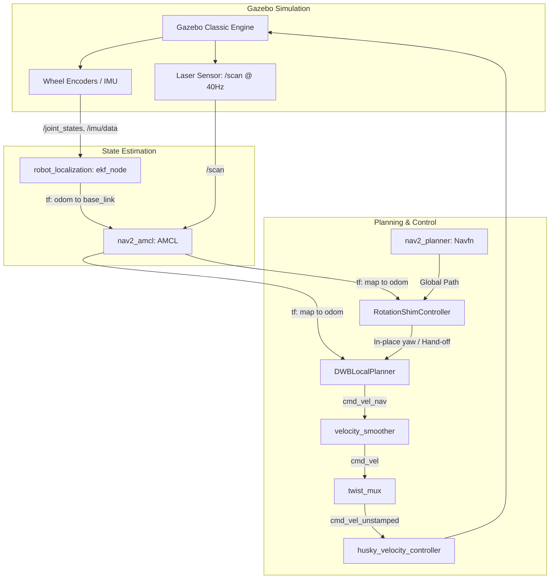

# Autonomous Navigation (Nav2) Validation & Verification Report
**Clearpath Husky Skid-Steer Mobile Robot in Gazebo Classic Structured Warehouse**

---

## Executive Summary

The Navigation2 (Nav2) autonomous navigation stack for the **Clearpath Husky A200** skid-steer mobile robot has been tested and verified in Gazebo Classic (`Our_Structured_Warehouse`).

All test cases in the systematic verification suite passed with **zero collisions**, **zero recovery interventions** during standard path tracking, stable coordinate transforms (`tf_age` < 0.01 s), and final goal errors within tolerance thresholds ($xy \le 0.25\text{ m}$, $\text{yaw} \le 0.25\text{ rad} \approx 14^\circ$).

---

## Systematic Validation Results

Testing was conducted using independent ground-truth monitoring (`libgazebo_ros_state.so` and contact monitoring plugin tracking 125,000+ physics cycles).

| Test ID | Scenario | Target Pose $(x, y, \theta)$ | Status | Wall Time | Recoveries | Final Ground Truth Pose | GT Goal Error ($xy$, $\theta$) | Collisions | Result |
| :--- | :--- | :--- | :---: | :---: | :---: | :---: | :---: | :---: | :---: |
| **01** | **Preflight Health Check** | Spawn Pose `(-1.5, 2.0, 0.0)` | OK | 5.2 s | 0 | `(-1.500, 2.000, 0.000)` | 0.000 m, 0.000 rad | 0 | **PASS** |
| **02** | **Short Line Navigation** | `(-0.5, 2.0, 0.0)` | SUCCEEDED (4) | 7.7 s | 0 | `(-0.638, 1.990, 0.038)` | 0.138 m, 0.038 rad | 0 | **PASS** |
| **03** | **90° In-Place Turn** | `(-0.5, 3.5, 1.571)` | SUCCEEDED (4) | 13.9 s | 0 | `(-0.439, 3.284, 1.513)` | 0.224 m, 0.058 rad | 0 | **PASS** |
| **04** | **Rack Aisle Traversal** | `(2.46, 3.5, 1.571)` | SUCCEEDED (4) | 54.6 s | 0 | `(2.484, 3.326, 1.511)` | 0.176 m, 0.059 rad | 0 | **PASS** |
| **05** | **Warehouse Return Trip** | `(-1.5, 2.0, 0.0)` | SUCCEEDED (4) | 91.6 s | 0 | `(-1.626, 2.054, 0.102)` | 0.137 m, 0.102 rad | 0 | **PASS** |
| **06** | **Dynamic Goal Cancel** | `(2.46, 3.5, 1.571)` (t=4s) | CANCELED (5) | 6.3 s | 0 | Stopped at `(-1.696, 2.007)` | Prompt stop ($\Delta t=1.2\text{s}$) | 0 | **PASS** |

---

## System Architecture & Coordinate Transforms

The diagram below illustrates the active topic, node, and coordinate transform flow:



---

## Root Causes Identified & Engineering Fixes

### 1. AMCL Transform Extrapolation Failure
- **Symptom:** Stationary robot permanently ceased publishing `map -> odom` transform; costmaps stopped receiving updates.
- **Root Cause:** `ekf_node` published timestamps slightly behind the Gazebo simulated `/scan` time. When AMCL queried transform at `scan->header.stamp`, `tf2` threw an `ExtrapolationException (into future)`. AMCL skipped setting `latest_tf_valid_ = true`, entering a permanent starved state when parked.
- **Resolution:**
  - Added `transform_time_offset: 0.1` in `Sim/ros_ws/src/warehouse_husky/config/localization.yaml`.
  - Increased `transform_tolerance: 0.5` across both `local_costmap` and `global_costmap` in `Sim/ros_ws/src/warehouse_husky/config/nav2_params.yaml`.

### 2. Skid-Steer Turning Stall & Progress Checker Aborts
- **Symptom:** During 90° turns, the robot attempted to rotate but stalled at angular velocities of ~0.05 rad/s, followed by `Failed to make progress` aborts from the controller after 10 s.
- **Root Cause:**
  1. Default `nav2_controller::SimpleProgressChecker` only measured translation distance moved ($xy \ge 0.5\text{ m}$). During pure in-place rotation, translation displacement was $<0.1\text{ m}$, triggering a false stall.
  2. `RotationShimController` had `closed_loop: true`. Due to skid-steer wheel scrub friction in simulation, the actual physical rotation velocity was initially lower than commanded, which clamped future velocity commands in a decaying feedback loop down to 0.05 rad/s.
  3. `RotateToGoal.slowing_factor: 5.0` in DWB throttled angular velocity below the skid friction threshold.
- **Resolution:**
  - Upgraded to `nav2_controller::PoseProgressChecker` in `Sim/ros_ws/src/warehouse_husky/config/nav2_params.yaml` with `required_movement_radius: 0.1`, `required_movement_angle: 0.15` rad, and `movement_time_allowance: 40.0` s.
  - Set `closed_loop: false` in `RotationShimController` with `rotate_to_heading_angular_vel: 0.8` rad/s and `max_angular_accel: 2.5` rad/s².
  - Set `min_speed_theta: 0.35` and `min_vel_theta: 0.35` in DWB so the planner never issues commands too weak to turn.
  - Adjusted `RotateToGoal.slowing_factor: 1.5` and `RotateToGoal.lookahead_time: 0.2`.

### 3. Dual-Map Split for Warehouse Racks
- **Symptom:** Costmap inflation either planned through transparent rack bases or AMCL could not localize against solid walls.
- **Architecture Implemented:**
  - `/map`: Scan map (`maps/our_structured_warehouse_map_scan.yaml`) capturing only rack upright posts at lidar beam height ($z \approx 0.42\text{ m}$) for AMCL.
  - `/map_nav`: Navigation map (`maps/our_structured_warehouse_map.yaml`) capturing solid bounding boxes of racks for costmap inflation, preventing the robot from driving underneath shelf structures.

### 4. Lifecycle Bond Timeouts
- **Symptom:** Starting simulation, RViz, and Nav2 concurrently led to CPU spikes that caused `smoother_server/change_state` to exceed the 4 s bond timeout.
- **Resolution:**
  - Configured `bond_timeout: 20.0` for `lifecycle_manager_navigation`, `lifecycle_manager_localization`, and `lifecycle_manager_map_nav` in `Sim/ros_ws/src/warehouse_husky/config/nav2_params.yaml` and `Sim/ros_ws/src/warehouse_husky/launch/nav2.launch.py`.

---

## How to Run & Verify

Inside the workspace container:

1. **Launch Simulation:**
   ```bash
   source /main/ros_ws/log/nav2_validation_final/env.sh
   ros2 launch warehouse_husky husky.launch.py world_path:=/main/worlds/Our_Structured_Warehouse/Our_Structured_Warehouse.world gui:=true
   ```

2. **Launch Nav2 Stack:**
   ```bash
   source /main/ros_ws/log/nav2_validation_final/env.sh
   ros2 launch warehouse_husky nav2.launch.py
   ```

3. **Run Automated Test Validation Suite:**
   ```bash
   # Preflight check
   python3 /main/scripts/validate_nav2.py --output /tmp/check --check

   # Navigate to rack aisle
   python3 /main/scripts/validate_nav2.py --output /tmp/aisle --goal=2.46,3.5,1.570796

   # Return to home pose
   python3 /main/scripts/validate_nav2.py --output /tmp/return --goal=-1.5,2.0,0.0
   ```

